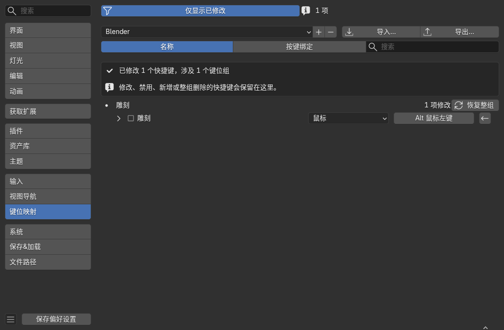

# Keymap Manager

Keymap Manager 是一个 Blender 5.3 扩展，用于在偏好设置中只显示被用户修改过的快捷键。



## 功能

- 在 `编辑 > 偏好设置 > 键位映射` 顶部添加“仅显示已修改”按钮。
- 显示被更改、禁用、删除或新增的快捷键。
- 保留 Blender 原有的编辑、搜索、导入、导出、单项恢复和整组恢复功能。
- 按快捷键或功能名称筛选修改项。
- 在 Blender 重启后自动加载用户最后选择的键位方案。

## 系统要求

- Blender 5.3 或更高版本。
- 已在 Blender 5.3 Release Candidate 中测试。

## 安装

### 从 GitHub Release 安装

1. 下载 `keymap_manager-<version>.zip`。
2. 打开 Blender。
3. 进入 `编辑 > 偏好设置 > 插件`。
4. 点击安装按钮并选择下载的 ZIP。
5. 启用 **Keymap Manager**。

### 从源码构建

把 Blender 的可执行文件路径替换为你的实际安装位置：

```powershell
$repo = "C:\path\to\Keymap-Manager"
$blender = "C:\Program Files\Blender Foundation\Blender 5.3\blender.exe"

& $blender --factory-startup --command extension build `
  --source-dir $repo `
  --output-dir "$repo\release"
```

构建完成后，在 Blender 的插件页面安装 `release\keymap_manager-<version>.zip`。

## 使用

1. 打开 `编辑 > 偏好设置 > 键位映射`。
2. 点击顶部的“仅显示已修改”。
3. 修改、禁用、删除或新增快捷键。
4. 再次点击该按钮可返回完整键位列表。

如果某个键位组的默认快捷键被整体删除，列表会保留该键位组，并提供“恢复整组”按钮。

## 项目结构

```text
Keymap-Manager/
├── __init__.py
├── blender_manifest.toml
├── README.md
├── PUBLISHING.md
├── CHANGELOG.md
├── LICENSE
└── docs/
    └── keymap-manager.png
```

## 发布新版本

详细步骤见 [PUBLISHING.md](PUBLISHING.md)。

## 许可证

GPL-3.0-or-later，详见 [LICENSE](LICENSE)。

